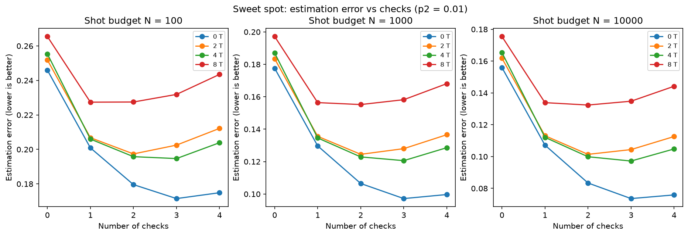
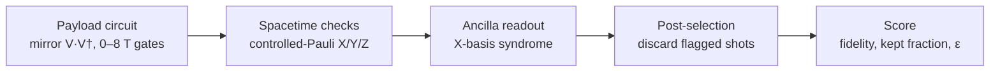

<p align="center">
  
</p>

<p align="center">
  <b>A puzzle game about where to place quantum error-detection checks.</b><br>
  Every score is computed by running the player's circuit in Qiskit Aer.
</p>

<p align="center">
  
  
  
  
  
  
</p>

<p align="center">
  <a href="#-video-presentation"><b>Video</b></a> ·
  <a href="REPORT.md"><b>Report</b></a> ·
  <a href="REPORT.pdf"><b>Report (PDF)</b></a> ·
  <a href="#-quick-start"><b>Quick start</b></a> ·
  <a href="#-key-findings"><b>Findings</b></a> ·
  <a href="#-how-the-game-maps-to-the-physics"><b>Physics</b></a>
</p>

<p align="center">
  
</p>

---

## Overview

Error detection protects a quantum computation by adding ancilla qubits that **check** it, and discarding every shot where a check fires. It buys fidelity by throwing data away, and every check adds noisy gates of its own. So the real question is not *whether* to add checks, but **how many and where**.

**Checkpoint** turns that question into a game. The circuit is drawn as a spacetime grid, with qubits as rows and gate layers as columns. The player has a budget of ancillas and places **coherent Pauli checks** (low-overhead spacetime-code checks, as implemented by [qiskit-paulice](https://pypi.org/project/qiskit-paulice/)). Pressing **Run on Qiskit** simulates the checked circuit under noise, post-selects the shots, and scores the result.

- **T gates are walls.** T is diagonal, so it commutes with Z but not with X or Y. A check may cross a T gate only if it acts as I or Z on that qubit, and the game enforces this live.
- **You can watch the physics happen.** A propagation inspector shows how each check's Pauli changes gate by gate, and the error replay shows exactly which errors your checks catch and which slip through.
- **The score is a real trade-off.** It charges for both the errors the checks missed *and* the shots they discarded, so more checks are not always better.
- **Nothing is hand-set.** Every number on screen comes from a Qiskit Aer run, and the results screen shows the Qiskit version, noise level, shot count and seed that produced it.

Built by **Team Dhurander** for the **Qiskit Fall Fest 2026 Hackathon, Advanced Track**: *Gamifying Error Detection, Mitigation and Correction: error detection with spacetime codes* (challenge provided by IBM Quantum).

## 🎬 Video presentation

**Watch the walkthrough:** [youtu.be/VIDEO_LINK](https://youtu.be/VIDEO_LINK) (also in [`video.md`](video.md))

## 📄 Report

The full write-up is in **[REPORT.md](REPORT.md)**, also available as a **[PDF](REPORT.pdf)**: background, method, all results with figures and tables, a worked example, the game design, how the project meets each required step and judging criterion, limitations and future work.

---

## 🔑 Key findings

All numbers are from Qiskit Aer simulations of a 4-qubit mirror circuit at 1% two-qubit error unless stated; see the report for full tables.

| # | Finding | Evidence |
|---|---|---|
| 1 | **T gates shrink the space of valid checks.** | Valid placements fall from 252 (0 T gates) to 139 (8 T gates), a 45% drop. |
| 2 | **More T gates lower the fidelity checks can reach.** | Best post-selected fidelity: 0.937 with no T gates vs. 0.878 with eight. |
| 3 | **Deeper circuits gain more from checks.** | Gain from three checks: +0.021 at depth 8 vs. +0.170 at depth 32. |
| 4 | **The best number of checks moves.** | At 1% error a 4th check never helps; at 3% error 3–4 checks win; with 8 T gates and only 100 shots, a single check is best. |

The best configuration overall is qiskit-paulice with four checks on the Clifford circuit: **fidelity 0.847 → 0.951 while keeping 75% of shots**.

<p align="center">
  <br>
  <i>Estimation error against number of checks for three shot budgets. The minimum of each curve is the sweet spot.</i>
</p>

---

## 🎮 The game

| Screen | What you do |
|---|---|
| **Missions** | Four levels with 0, 2, 4 and 8 T gates, each with a 3-ancilla budget and a preview of its T walls |
| **Workbench** | Pick an X, Y or Z check, click a start cell and an end cell on a qubit, see it validated live against the T walls, and follow it in the **propagation inspector**. A 4-step tutorial explains the rules on first visit |
| **Run results** | Fidelity with and without checks, shots kept, overhead, the **output distribution before and after post-selection**, the syndrome counts, and the score split into bias and statistical error |
| **Results Lab** | Your run against every computed configuration, the Pareto frontier, the error-vs-checks curve and a cross-level benchmark; change the shot budget to move the sweet spot |
| **Replay** | *What slipped through?* Every single-qubit X, Y and Z error after every gate is tested against your checks: caught (anti-commutes) or slipped through |
| **Rulebook** | The anatomy of a check, each game rule and the physics behind it, and the limitations |

<p align="center">
  
  &nbsp;
  
</p>

**Try this first:** open Level 3. Place an **X** check on q0 from step 0 to step 13: it is rejected at the T wall. Switch to **Z** on the same span: it is accepted, and the inspector shows it turning into −Y by the end. Run it. Then add a second check and run again: fidelity barely moves, fewer shots survive, and the score gets worse. **Placement beats quantity.** Finally, open **Replay** to see which errors your check could never have seen.

**Motion with a purpose.** The circuit builds itself gate by gate when a level opens, rejected checks shake at the wall they hit, the propagation inspector reveals a check's Pauli step by step, the output distributions grow before and after post-selection, and the Pareto frontier draws itself in the Results Lab. All animation switches off automatically when the system's *reduce motion* setting is on.

**Keyboard shortcuts** on the workbench: <kbd>X</kbd> <kbd>Y</kbd> <kbd>Z</kbd> pick an operator · <kbd>Esc</kbd> cancel a placement · <kbd>Backspace</kbd> remove the last check · <kbd>Enter</kbd> run. In the replay, <kbd>←</kbd> <kbd>→</kbd> step through errors.

---

## 🚀 Quick start

**Requirements:** Python 3.11+ and Git. No IBM Quantum account is needed; everything runs locally.

```bash
git clone https://github.com/Am-berneal/checkpoint.git
cd checkpoint
python -m venv .venv
```

Activate the environment:

| System | Command |
|---|---|
| Windows (PowerShell) | `.venv\Scripts\Activate.ps1` |
| Windows (Command Prompt) | `.venv\Scripts\activate` |
| macOS / Linux | `source .venv/bin/activate` |

Then install and precompute the game data:

```bash
pip install -r requirements.txt
python precompute.py
```

### Play the game

Open two terminals, both with the environment activated:

```bash
# Terminal 1: the Qiskit backend
uvicorn api:app --reload
```

```bash
# Terminal 2: the game UI
cd frontend
python -m http.server 8080
```

Open **http://127.0.0.1:8080** in your browser (any free port works). The API's interactive docs are at http://127.0.0.1:8000/docs.

### Reproduce every result

```bash
python run_phase1.py     # payload family, ideal reference, baseline fidelity
python run_phase2.py     # qiskit-paulice checks + post-selection (Clifford payload)
python run_phase3.py     # hand-made checks across T gates, shot-budget sweet spot
python run_depth.py      # effect of circuit depth
python precompute.py     # game cache + Pareto data
python make_figures.py   # circuit diagrams and the worked example
```

Every CSV and figure is written to `results/`. All runs use fixed seeds, so the numbers in the report are regenerated exactly. The full set takes about two minutes on a laptop.

---

## ⚛️ How it works



1. **Payload.** A 4-qubit mirror circuit: a random Clifford block with T gates inserted, followed by its exact inverse, so the ideal output is always |0000⟩. Using a mirror removes a measurement artifact in which noise appeared to *raise* fidelity as T gates were added.
2. **Reference.** Ideal outputs come from stabilizer simulation (Clifford) and statevector simulation (T-doped). Fidelity is the Hellinger fidelity between ideal and measured distributions, which here equals the probability of the correct answer.
3. **Checks.**
   - *Clifford circuit:* `qiskit_paulice.add_pauli_checks`, varying the number and order of target qubits, with post-selection from the add-on's own `get_postselection_method()`.
   - *T-doped circuits:* the add-on accepts Clifford circuits only, so we built checks by hand. Each Pauli is propagated through the circuit with `Pauli.evolve`; it is rejected if it carries X or Y into a T gate, and overlapping checks must commute. Verified noiselessly: no check ever fires without noise.
4. **Noise and sampling.** A depolarizing noise model in Qiskit Aer (defined in one place, `core/noise.py`, so any announced model can be swapped in), sampled with the `SamplerV2` primitive.
5. **Score.** Estimation error at a fixed shot budget N:

   **ε = (1 − F<sub>post-selected</sub>) + 1 / √(N · kept fraction)**

   The first term is the bias from errors the checks missed; the second is the statistical error of the shots that survive. More checks lower the first and raise the second, so ε has a minimum: the sweet spot.
6. **Error replay.** For every gate and every qubit it touches, the replay inserts a single X, Y or Z error and checks whether it lies inside a check's span and anti-commutes with that check's propagated Pauli at that point.

### 🔬 How the game maps to the physics

| Game rule | Physics |
|---|---|
| Ancilla budget | Space overhead of the spacetime code: one ancilla per check |
| Placing a check | Coherent Pauli check: controlled-P before a segment, controlled-U P U† after it, ancilla read in the X basis |
| A check "turns into" another Pauli | Pauli propagation through Clifford gates |
| Discarded shots | Post-selection on a non-trivial syndrome |
| T wall | T is diagonal, so only I or Z commute through it |
| Overlapping checks must commute | Anti-commuting checks disturb each other's syndrome |
| Caught vs slipped (Replay) | An error is detected only if it anti-commutes with a check inside its span |
| Score | Bias plus statistical error at a fixed shot budget |

---

## 📁 Repository layout

```
checkpoint/
├── core/
│   ├── payloads.py      # mirror payload family with nested T positions
│   ├── reference.py     # ideal distributions and Hellinger fidelity
│   ├── noise.py         # depolarizing noise model (single place to swap models)
│   ├── run.py           # Aer SamplerV2 runners and post-selection
│   ├── checks.py        # qiskit-paulice wrapper and overhead metrics
│   ├── handchecks.py    # hand-made checks: propagation, T walls, commutation
│   ├── score.py         # estimation error ε
│   └── game.py          # levels, validation, traces, scoring, error replay, cache
├── frontend/
│   └── index.html       # the game UI (single file)
├── api.py               # FastAPI backend
├── run_phase1.py        # baseline
├── run_phase2.py        # qiskit-paulice checks
├── run_phase3.py        # hand-made checks and sweet spot
├── run_depth.py         # depth study
├── precompute.py        # game data
├── make_figures.py      # report figures
├── results/             # CSV files and figures
├── assets/              # logo and screenshots
├── REPORT.md            # written report
├── REPORT.pdf           # written report (PDF)
├── video.md             # video link
└── requirements.txt
```

## 🛠️ Troubleshooting

| Problem | Fix |
|---|---|
| `Activate.ps1 cannot be loaded` in PowerShell | Run `Set-ExecutionPolicy -Scope Process -ExecutionPolicy RemoteSigned`, then activate again |
| Red "Backend not reachable" bar in the game | Start the backend in terminal 1: `uvicorn api:app --reload` |
| `MissingOptionalLibraryError: pylatexenc` | `pip install pylatexenc` (needed for circuit drawings) |
| The Results Lab is empty | Run `python precompute.py`, then restart the backend |
| Icons are missing | The UI loads Bootstrap Icons from a CDN, so the browser needs an internet connection |
| An old version of the page appears | Another server (for example VS Code Live Server) is using the port. Serve on a different port, e.g. `python -m http.server 8090`, and press <kbd>Ctrl</kbd>+<kbd>Shift</kbd>+<kbd>R</kbd> |

## ⚠️ Limitations

- Detection discards errors but never repairs them; errors that commute with every check reach the kept shots undetected.
- All results are simulated on 4 qubits with a synthetic depolarizing model.
- On today's IBM hardware T is a virtual rz(π/4); its error rate here is an assumption reflecting the fault-tolerant setting.
- Device connectivity is ignored; on real hardware, long-range checks would need SWAP gates.
- Each configuration uses one seed, so fidelity differences below about 0.01 are within shot noise.

See [REPORT.md](REPORT.md#7-limitations) for the full discussion and future work.

---

## 👤 Team Dhurander

Solo project by **Amberneal Singh** ([@Am-berneal](https://github.com/Am-berneal)): physics, analysis, game engine, UI and write-up.

## 🙏 Acknowledgements

- **IBM Quantum** and the **Qiskit Fall Fest 2026** organizers for the challenge.
- The **qiskit-paulice** add-on and the method of Martiel and Javadi-Abhari, *Low-overhead error detection with spacetime codes*, [arXiv:2504.15725](https://arxiv.org/abs/2504.15725).
- D. Litinski, *A Game of Surface Codes*, Quantum 3, 128 (2019), for showing how QEC ideas can become game rules.

## 📜 License

This project is released under the Apache License 2.0. See [LICENSE](LICENSE).
