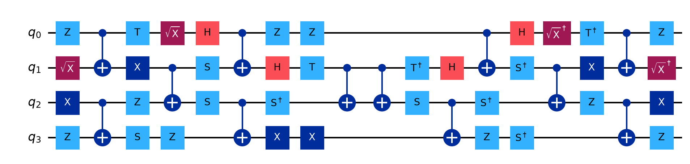
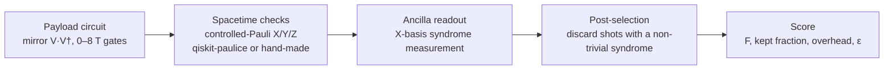
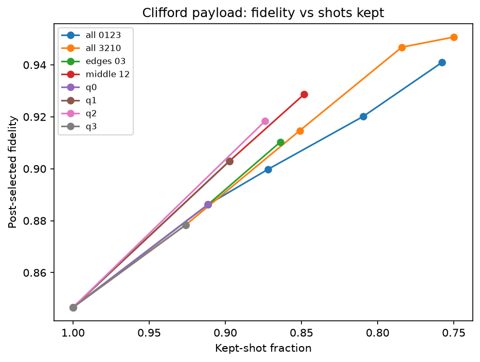
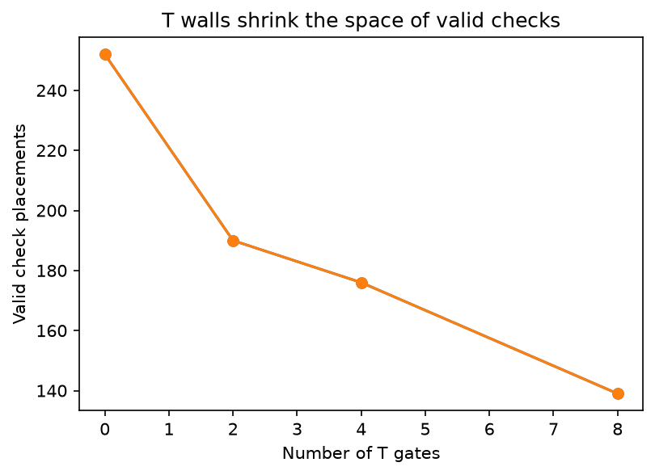
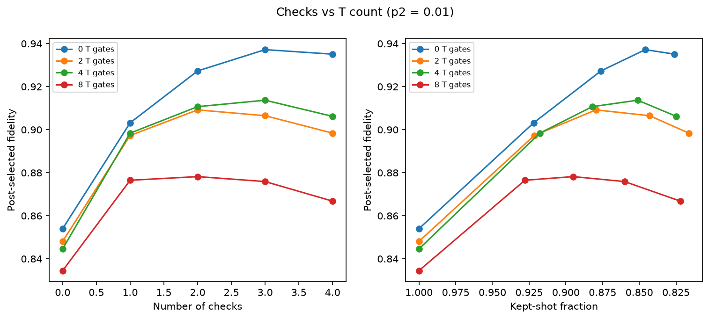
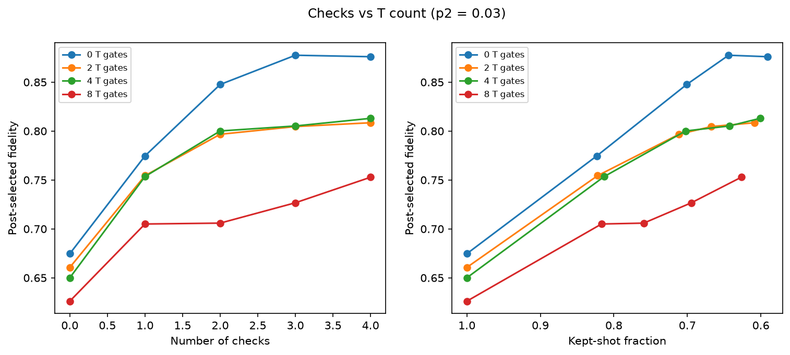
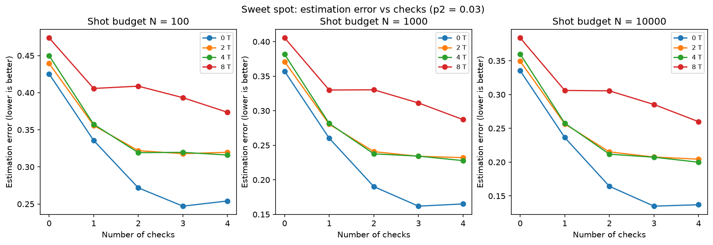
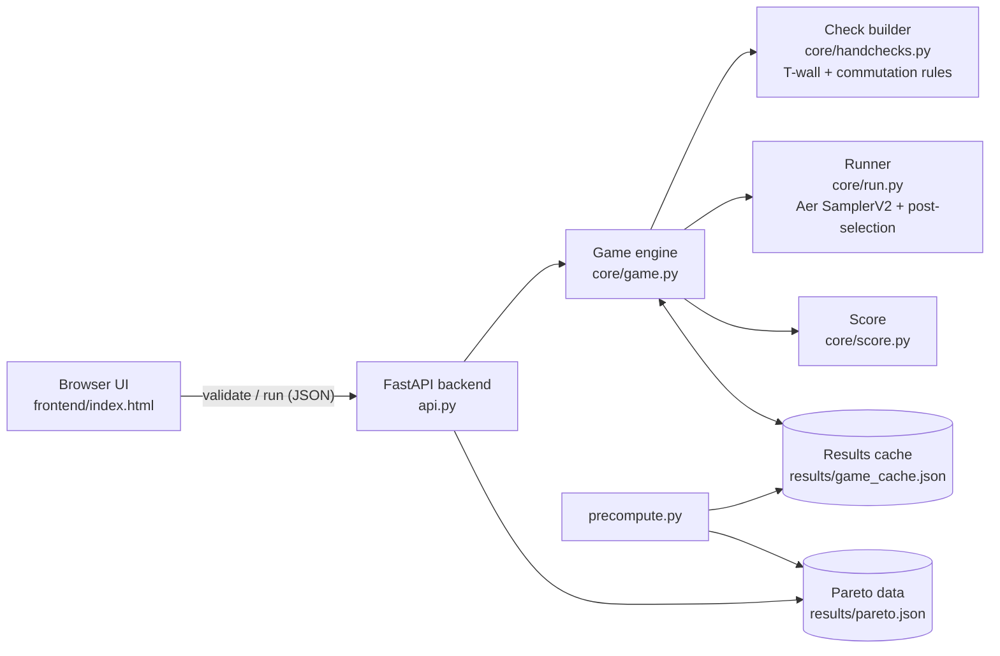

<p align="center">
  
</p>

<h1 align="center">Checkpoint</h1>
<p align="center"><b>A puzzle game about where to place error-detection checks</b></p>

<p align="center">
Qiskit Fall Fest 2026 Hackathon · Advanced Track<br>
<i>Gamifying Error Detection, Mitigation and Correction: error detection with spacetime codes</i>
</p>

| | |
|---|---|
| **Team** | **Dhurander** (solo): Amberneal Singh |
| **Repository** | [github.com/Am-berneal/checkpoint](https://github.com/Am-berneal/checkpoint) |
| **Video presentation** | _add the video link here_ (also in `video.md`) |
| **Challenge** | Error-detection track, provided by IBM Quantum for Qiskit Fall Fest 2026 |
| **Software** | Qiskit 2.5.2 · qiskit-aer 0.17.2 · qiskit-paulice 0.2.1 · Python 3.13 |

---

## Contents

1. [Summary](#1-summary)
2. [Background](#2-background)
3. [Method](#3-method)
4. [Results](#4-results)
5. [The game](#5-the-game)
6. [How the project meets the brief](#6-how-the-project-meets-the-brief)
7. [Limitations](#7-limitations)
8. [Conclusion and future work](#8-conclusion-and-future-work)
9. [Reproducing the results](#9-reproducing-the-results)
10. [Appendices](#appendix-a-full-results-tables)

---

## 1. Summary

Checkpoint is a puzzle game in which the player protects a quantum circuit from noise by placing **coherent Pauli checks** on it. The circuit is drawn as a spacetime grid (qubits as rows, gate layers as columns). The player has a budget of ancilla qubits, chooses where each check starts and ends and which Pauli it uses, and presses **Run on Qiskit**. The checked circuit is simulated in Qiskit Aer under noise, shots whose checks fire are discarded, and the score is computed from the counts. **No score in the game is set by hand.**

The analysis behind the game produced four findings:

| # | Finding | Key numbers (1% two-qubit error unless stated) |
|---|---|---|
| 1 | **T gates shrink the space of valid checks.** A check may cross a T gate only if it acts as I or Z on that qubit. | Valid single-check placements: 252 (0 T) → 190 (2 T) → 176 (4 T) → 139 (8 T) |
| 2 | **More T gates lower the fidelity checks can reach.** | Best post-selected fidelity: 0.937 (0 T) → 0.878 (8 T) |
| 3 | **Deeper circuits gain more from checks.** | Gain from 3 checks (Clifford): +0.021 at depth 8 → +0.170 at depth 32 |
| 4 | **"More checks" is not always better, and the best number moves.** | 4th check never helps at 1% error; 3–4 checks best at 3% error; 1 check best with 8 T gates and N = 100 shots |

The game turns these findings into play: in Level 3 a single well-placed check scores better than the same check plus a second one, because the second check discards 6% more shots for almost no gain in fidelity.

---

## 2. Background

### 2.1 Detection, mitigation and correction

| | Error detection (this project) | Error mitigation | Error correction |
|---|---|---|---|
| **Idea** | Ancilla checks flag errors they can see; flagged shots are discarded | Hardware stays noisy; the estimate of an observable is corrected in post-processing (ZNE, PEC, twirling, readout correction) | One logical qubit is encoded in many physical qubits; stabilizers are measured repeatedly and a decoder undoes errors during the computation |
| **Repairs the state?** | No | No | Yes |
| **Main cost** | Discarded shots, extra ancillas and gates | Extra circuits and shots | Many physical qubits, fast decoding |
| **Scales to fault tolerance?** | Not by itself | No | Yes, below threshold |

Detection buys fidelity by throwing shots away. A post-selected fidelity is therefore meaningless on its own: a strategy that keeps 2% of shots cannot be compared with one that keeps 80%. Throughout this report and the game, **post-selected fidelity is always reported together with its kept-shot fraction.**

### 2.2 From Shor's code to spacetime codes

Shor's 9-qubit code (1995) showed that a logical qubit can be protected against both bit flips (X) and phase flips (Z). CSS and stabilizer codes generalised the idea; Kitaev's topological codes led to the **surface code**, which needs only nearest-neighbour checks on a 2D grid; and **qLDPC codes** such as the [[144, 12, 12]] bivariate bicycle code cut the qubit overhead by using checks that reach beyond nearest neighbours.

All of these measure **stabilizers**: Pauli operators that leave the correct state unchanged, so a non-trivial measurement outcome (a **syndrome**) signals an error. Spacetime codes apply the same idea to a whole *circuit* instead of a stored state: a check compares a Pauli before a segment of the circuit with the same Pauli carried through to the end of the segment.

### 2.3 Coherent Pauli checks

A check on a circuit segment U works as follows:

1. Prepare an ancilla in |+⟩.
2. Before U, apply a controlled Pauli **P** from the ancilla to the data qubits.
3. Let the segment U run.
4. After U, apply a controlled **P′ = U P U†**: the same Pauli carried through the segment.
5. Measure the ancilla in the X basis.

With no errors, P′ U P = (U P U†) U P = U P² = U, so the ancilla returns to |+⟩ and reads 0: the check is invisible to the computation. An error E inside the segment that **anti-commutes** with the propagated check flips the ancilla to |−⟩, the ancilla reads 1, and the shot is discarded. An error that **commutes** with the check passes undetected. This is why detection cannot reach fidelity 1.

When U is a Clifford circuit, P′ is always another Pauli and is cheap to apply. qiskit-paulice finds good checks for Clifford circuits automatically.

### 2.4 Why T gates are walls

A T gate is diagonal: T = diag(1, e^{iπ/4}). It commutes with Z and I, so a Z or I component passes through it unchanged. It does **not** commute with X or Y: T X T† = (X + Y)/√2, which is not a Pauli, so the closing operation would no longer be a cheap controlled Pauli and the check would alter the computation. A hand-made check is therefore valid across a T gate **only if its propagated Pauli acts as I or Z on that qubit at that point**. In the game this rule becomes a **T wall**.

A subtle consequence, which the game shows directly: a check that *starts* as Z can still be blocked, because the Clifford gates before the wall can turn it into an X or Y by the time it arrives.

---

## 3. Method

### 3.1 Payload circuits

We use a 4-qubit **mirror circuit**. A random Clifford block V is built from brickwork layers: in each layer every qubit receives a random single-qubit Clifford (H, S, S†, √X, X or Z), followed by CX gates on alternating neighbouring pairs (seed 7). T gates are inserted after randomly chosen gates of V, and the circuit is completed with the exact inverse of the T-doped block.


*Figure 1. The payload with two T insertions (four non-Clifford gates, T and T†). The second half is the exact inverse of the first, so the ideal output is |0000⟩.*

**Design choices:**

- **Mirror construction.** Every circuit in the family has the same ideal output, |0000⟩. In a first version only the Clifford part was undone, so the T gates spread the ideal output over 2–8 bitstrings, and noise then appeared to *raise* fidelity as T gates were added (from 0.854 to 0.937), because noise barely changes a distribution that is already spread out. Mirroring the T gates as well removes this artifact. The middle of each circuit is still a genuinely non-Clifford state.
- **Nested T positions.** T positions come from one fixed random permutation, so the circuit with two insertions contains the one-insertion circuit's T gate. The family differs only in T count.
- **No transpilation.** The default transpiler would cancel V against V†. Aer runs these gates directly.

**Table 1.** The payload family (4 brickwork layers).

| T insertions | Non-Clifford gates (T + T†) | Width | Depth | CX gates | Accepted by qiskit-paulice? |
|---|---|---|---|---|---|
| 0 | 0 | 4 | 16 | 12 | Yes |
| 1 | 2 | 4 | 18 | 12 | No |
| 2 | 4 | 4 | 18 | 12 | No |
| 4 | 8 | 4 | 20 | 12 | No |

For the depth study (Section 4.4) the number of brickwork layers is varied from 2 to 8, giving depths of 8 to 34.

### 3.2 Ideal reference and fidelity measure

- **Clifford circuit:** ideal output from the **stabilizer simulator** (`StabilizerState`).
- **T-doped circuits:** ideal output from **statevector simulation** (`Statevector`), which is exact and cheap at 4 qubits.
- **Fidelity:** the **Hellinger fidelity** between the ideal and measured output distributions (`qiskit.quantum_info.hellinger_fidelity`). *Justification: the game's observable is the measured bitstring, and post-selection acts on shot counts.* Because the ideal output is the single bitstring 0000, the Hellinger fidelity here equals the probability of measuring the correct answer.

As a correctness check, noiseless sampling of every payload gives fidelity 1.000.

### 3.3 Noise model

The organizers allow a synthetic noise model, so we use a depolarizing model in Qiskit Aer. It is defined in one function (`core/noise.py`) so that an announced model or a fake-backend model can replace it in one place.

| Parameter | Value |
|---|---|
| Two-qubit gate error p2 (CX, CZ) | 1% (main analysis); 2% (game); 3% (high-noise sweep) |
| Single-qubit Clifford error | p2 / 10 |
| T and T† error | p2 / 2 (0.5% in Phases 1–2) |
| Readout error | 1%, symmetric |

The same p2 and readout error are passed to qiskit-paulice (`NoiseModel(gate_noise=p2, readout_noise=0.01)`) when it chooses checks, so the checks are optimised for the noise they will meet.

All sampling uses the **`SamplerV2` primitive** from qiskit-aer with fixed seeds (simulation seed 1234). The analysis uses 8192 shots per configuration and the game 4096.

### 3.4 Pipeline

Every configuration goes through the four stages the brief asks the game to expose:



### 3.5 Checks on the Clifford circuit (qiskit-paulice)

For the Clifford payload, `add_pauli_checks` is called with `cost="gamma"`, `method="windowed"` and `seed=1`, a combination the documentation describes as fully deterministic. It returns one circuit per number of checks, from 0 up to one check per target qubit. We varied:

- **how many checks** (every element of the returned list), and
- **which target qubits and in what order**: all four in both orders, the middle pair, the edge pair, and each qubit alone.

Post-selection uses the add-on's own `get_postselection_method()` rather than a hand-written "ancilla = 0" rule, because a check's syndrome can combine ancilla bits **and** data-qubit bits.

We confirmed that the add-on rejects every T-doped circuit (it raises an error naming the unsupported `t` and `tdg` gates).

### 3.6 Hand-made checks on the T-doped circuits

For the T-doped circuits we wrote our own checks (`core/handchecks.py`):

1. **Definition.** A check is a start instruction, an end instruction and a weight-1 Pauli P on one qubit.
2. **Propagation.** P is pushed gate by gate through the segment with Qiskit's `Pauli.evolve`. On reaching a T or T† gate, the check is **rejected** if the propagated Pauli has an X or Y component on that qubit; otherwise it passes unchanged.
3. **Closing operation.** The propagated Pauli P′ (which may have weight greater than 1 and a sign) gives the closing controlled operation: CX for X, CZ for Z, S†·CX·S for Y, and a Z on the ancilla for a minus sign.
4. **Compatibility.** Checks that overlap in time must commute at each other's start and end points; otherwise one check disturbs the other's syndrome.

**Verification.** Every hand-made check circuit was run without noise: no check ever fires. An early version produced false alarms when two overlapping checks anti-commuted; the compatibility test in step 4 fixed this.

**Search.** Candidate checks were enumerated on a grid of 6 time windows × 4 qubits × 3 Paulis. Each valid candidate was screened alone (1000 shots). A greedy search then added the best candidate compatible with those already chosen, up to 4 checks. Each resulting configuration was re-run with 8192 shots.

### 3.7 Worked example: one check on Level 3

Level 3 of the game is the 4-T payload drawn as 18 time steps, with T walls at steps 2, 7, 10 and 15.

| Player's choice | Result | Why |
|---|---|---|
| **X** on q0, steps 0–13 | **Rejected** | X on q0 meets the T gate at step 2 |
| **Z** on q0, steps 0–13 | **Valid**; closes as **−IIIY** | Z passes the T at step 2; the Clifford gates turn it into −Y on q0 by step 13, before the next wall at step 15 |
| **Z** on q2, steps 3–12 | **Rejected** | The CX gates carry the Z onto q1 as an X before the T at step 7 |
| **X** on q2, steps 3–9 | **Valid**; closes as **−XXII** | It ends before any wall on the qubits it has spread to |


*Figure 2. The Level 3 payload with the valid Z check on q0. The ancilla (checks_q) is prepared with H, applies a controlled-Z at the start, a controlled-Y (S†·CX·S on q0) plus Z for the minus sign at the end, and is read out after a final H.*

Running these choices under 2% noise (4096 shots, scored at N = 1000):

| Configuration | F post-selected | Kept | Added 2-qubit gates | ε |
|---|---|---|---|---|
| No checks | 0.748 | 100% | 0 | 0.284 |
| Z on q0 (steps 0–13) | 0.794 | 90.3% | 2 | **0.240** |
| Z on q0 + X on q2 (steps 3–9) | 0.793 | 83.9% | 5 | 0.242 |

The second check discards another 6% of shots and adds three two-qubit gates, but catches no more net error. **A single check is the better play.**

### 3.8 The score: estimation error at a fixed shot budget

A configuration is scored by the total error of estimating the circuit's output with a fixed budget of N shots:

$$\varepsilon = \underbrace{(1 - F_{\text{post-selected}})}_{\text{bias from undetected errors}} + \underbrace{\frac{1}{\sqrt{N \cdot \text{kept fraction}}}}_{\text{statistical error of the kept shots}}$$

- The **bias** falls as checks catch more errors.
- The **statistical error** rises as checks discard more shots. Its scale constant is 1, a conservative upper bound on the binomial standard error (which is at most 1/(2√n)).
- The checks' own gates add noise, which pushes the bias back up.

ε therefore has a minimum, the **sweet spot**, and finding it is the goal of the game. This score respects the brief's rule that post-selected fidelity is meaningless without its kept-shot fraction, because the kept fraction is built into it.

---

## 4. Results

### 4.1 Baseline without checks

**Table 2.** Unchecked fidelity (1% two-qubit error, T error 0.5%, 8192 shots).

| T gates | Depth | Reference method | Ideal support | F (noiseless) | F (noisy) |
|---|---|---|---|---|---|
| 0 | 16 | stabilizer | 1 | 1.000 | 0.854 |
| 2 | 18 | statevector | 1 | 1.000 | 0.848 |
| 4 | 18 | statevector | 1 | 1.000 | 0.845 |
| 8 | 20 | statevector | 1 | 1.000 | 0.835 |

Fidelity falls steadily as T gates are added, as it should once the reference artifact (Section 3.1) is removed.

### 4.2 qiskit-paulice checks on the Clifford circuit

**Table 3.** Selected configurations. Unchecked fidelity: 0.847. Full table in Appendix A.

| Targets (in order) | Checks | F post-selected | Kept | Added 2-qubit gates | Added depth |
|---|---|---|---|---|---|
| q0, q1, q2, q3 | 1 | 0.885 | 91.3% | 3 | 13 |
| q0, q1, q2, q3 | 2 | 0.900 | 87.2% | 5 | 13 |
| q0, q1, q2, q3 | 3 | 0.922 | 80.8% | 8 | 18 |
| q0, q1, q2, q3 | 4 | 0.942 | 75.7% | 11 | 20 |
| q3, q2, q1, q0 | 3 | 0.947 | 78.4% | 9 | 20 |
| q3, q2, q1, q0 | 4 | **0.951** | 75.0% | 12 | 20 |
| q1, q2 | 2 | 0.929 | 84.8% | 5 | 14 |
| q2 only | 1 | 0.918 | 87.4% | 4 | 18 |
| q3 only | 1 | 0.878 | 92.6% | 3 | 11 |


*Figure 3. Post-selected fidelity against kept fraction for each set of target qubits. Moving right means more checks and fewer shots kept.*

- Checks lift fidelity from 0.847 to 0.951 while keeping 75% of shots.
- **Target order matters.** The add-on commits checks one target at a time, so the same four qubits in reverse order give different checks: three checks reach 0.947 in order q3→q0 but 0.922 in order q0→q3.
- **Location matters more than count.** One check on q2 (0.918 at 87.4% kept) beats two checks on q0 and q1 (0.900 at 87.2% kept) at the same cost in shots. Single checks on the four qubits range from 0.878 to 0.918.
- **Checks are not free.** Each adds 3–4 two-qubit gates and up to 20 layers of depth.

### 4.3 Hand-made checks across T gates

#### Finding 1: T walls shrink the check space

**Table 4.** Valid single-check placements on the candidate grid (6 windows × 4 qubits × 3 Paulis = 252 candidates).

| T gates | Valid | Blocked by a T wall | Blocked |
|---|---|---|---|
| 0 | 252 | 0 | 0% |
| 2 | 190 | 62 | 25% |
| 4 | 176 | 76 | 30% |
| 8 | 139 | 113 | 45% |


*Figure 4. Valid check placements fall as T gates are added. The game's own finer grid shows the same trend: 432 → 428 → 380 → 366 placements across Levels 1–4.*

#### Finding 2: more T gates lower the reachable fidelity

**Table 5.** Unchecked and best post-selected fidelity (greedy search, up to 4 checks).

| T gates | p2 = 1%: unchecked → best | Gain | p2 = 3%: unchecked → best | Gain |
|---|---|---|---|---|
| 0 | 0.854 → **0.937** (3 checks, 84.6% kept) | +0.083 | 0.675 → 0.878 (3 checks, 64.4% kept) | +0.203 |
| 2 | 0.848 → **0.909** (2 checks, 88.0% kept) | +0.061 | 0.661 → 0.809 (4 checks, 60.9% kept) | +0.148 |
| 4 | 0.845 → **0.914** (3 checks, 85.1% kept) | +0.069 | 0.650 → 0.813 (4 checks, 60.1% kept) | +0.163 |
| 8 | 0.835 → **0.878** (2 checks, 89.5% kept) | +0.043 | 0.626 → 0.753 (4 checks, 62.7% kept) | +0.127 |

At 1% noise, checks recover 0.083 of fidelity on the Clifford circuit but only 0.043 on the 8-T circuit: the checks that remain valid cannot reach the CX gates next to the T walls.



*Figures 5 and 6. Fidelity against number of checks (left) and against kept fraction (right), for each T count, at 1% and 3% two-qubit error.*

#### Finding 4: the sweet spot moves

**Table 6.** Number of checks that minimises ε.

| T gates | p2 = 1%, N = 100 | p2 = 1%, N = 1000 | p2 = 1%, N = 10 000 | p2 = 3%, N = 100 | p2 = 3%, N = 1000 | p2 = 3%, N = 10 000 |
|---|---|---|---|---|---|---|
| 0 | 3 | 3 | 3 | 3 | 3 | 3 |
| 2 | 2 | 2 | 2 | 3 | 4 | 4 |
| 4 | 3 | 3 | 3 | 4 | 4 | 4 |
| 8 | **1** | 2 | 2 | 4 | 4 | 4 |



*Figures 7 and 8. Estimation error against number of checks for three shot budgets. The minimum of each curve is the sweet spot.*

- **Low noise saturates early.** At 1% error the fourth check never helps and usually hurts: on the 2-T circuit fidelity peaks at 0.909 with two checks and falls to 0.898 with four. Each extra check adds two-qubit gates that create about as many errors as it catches.
- **High noise rewards more checks.** At 3% error there are many more errors to catch, so three or four checks are best in every case.
- **A small shot budget favours fewer checks.** With eight T gates at 1% noise, the optimum drops from two checks to one when N falls from 1000 to 100, because each discarded shot then costs more statistical error than the second check saves in bias.

In this regime the noise level moves the optimum more than the shot budget does, because the kept fraction stays above 60%. The shot-budget effect appears where fidelity gains are smallest, which is exactly the heavily T-doped case.

### 4.4 Finding 3: circuit depth

The brief lists circuit depth as a factor, so we varied the number of brickwork layers in V from 2 to 8 (1% error, greedy search, up to 3 checks; script `run_depth.py`).

**Table 7.** Effect of depth.

| Layers | Depth (0 T / 4 T) | CX | F, no checks (0 T) | Best F (0 T) | Gain | F, no checks (4 T) | Best F (4 T) | Gain | Valid checks (4 T) |
|---|---|---|---|---|---|---|---|---|---|
| 2 | 8 / 10 | 6 | 0.908 | 0.929 | +0.021 | 0.898 | 0.925 | +0.026 | 182 |
| 4 | 16 / 18 | 12 | 0.854 | 0.937 | +0.083 | 0.845 | 0.914 | +0.069 | 176 |
| 6 | 24 / 28 | 18 | 0.805 | 0.927 | +0.122 | 0.796 | 0.880 | +0.084 | 148 |
| 8 | 32 / 34 | 24 | 0.752 | 0.923 | +0.170 | 0.745 | 0.865 | +0.120 | 144 |


*Figure 9. Unchecked fidelity falls with depth, but checks recover much more on deeper circuits.*

- **Deeper circuits gain more from checks.** On the Clifford circuit the gain from three checks grows from +0.021 at depth 8 to +0.170 at depth 32: there are more errors to catch, and each check spans more CX gates.
- **T gates cap that gain.** With four T gates the gain at depth 32 is only +0.120, and the number of valid placements keeps falling.
- **Shallow circuits barely need checks.** At depth 8, the second and third checks add less than 0.005 of fidelity each.
- **Greedy choices can backfire.** At 6 and 8 layers with four T gates, the second greedy check *lowers* fidelity (0.867 → 0.857 and 0.842 → 0.829) before a third one raises it again. Checks interact; the best set is not built by adding the best single checks one at a time.

### 4.5 The game's own data

The game uses p2 = 2% and evaluates 60 random valid configurations per level for its Pareto chart.

**Table 8.** Sweet spot per level (N = 1000).

| Level | T gates | Valid placements | F, no checks | Sweet spot | ε |
|---|---|---|---|---|---|
| 1 Clean circuit | 0 | 432 | 0.764 | 1 check, F = 0.837, 86.9% kept | 0.197 |
| 2 First impurity | 2 | 428 | 0.754 | 1 check, F = 0.788, 91.8% kept | 0.246 |
| 3 T walls | 4 | 380 | 0.748 | 1 check, F = 0.794, 90.3% kept | 0.240 |
| 4 Magic overload | 8 | 366 | 0.730 | 2 checks, F = 0.766, 85.7% kept | 0.268 |

Random placements are much weaker than the greedy search: among random configurations a single well-placed check is usually best, and random extra checks make the score worse. This is the lesson the game is built around: **placement beats quantity**.

### 4.6 Which configuration wins, and why

The brief asks for the configuration with the best trade-off between post-selected fidelity and kept-shot fraction. Using ε at N = 1000 as the measure of that trade-off:

- **Clifford payload, 1% error:** the best configuration overall is qiskit-paulice with four checks in order q3→q0 (F = 0.951, 75.0% kept, ε = 0.086), just ahead of three checks in the same order (F = 0.947, 78.4% kept, ε = 0.089). The best hand-made set is three checks (F = 0.937, 84.6% kept, ε = 0.097): the add-on's optimised multi-qubit checks beat our weight-1 ones.
- **2–8 T gates, 1% error:** two checks are best; at 8 T gates and N = 100, one.
- **Why they win:** they cover the most CX gates (the dominant error source) with the fewest added two-qubit gates. A further check would spend more fidelity on its own gates, and more shots on post-selection, than it saves.

---

## 5. The game

### 5.1 Architecture



The game calls exactly the same functions as the analysis scripts. Results are cached by configuration so repeated moves are instant, and each cached result stores the Qiskit and Aer versions, noise level, shot count and seed, which the results screen displays.

**API endpoints:**

| Endpoint | Purpose |
|---|---|
| `GET /levels` | List of levels with T count, ancilla budget and best score |
| `GET /levels/{id}` | Circuit as a grid of gates, plus the unchecked baseline |
| `POST /levels/{id}/validate` | Checks one placement against the T walls; returns the closing Pauli (or the reason for rejection) and the step-by-step propagation trace |
| `POST /levels/{id}/run` | Runs a set of checks in Qiskit Aer and returns fidelities, kept fraction, overhead, ε, the output distributions with and without checks, and the syndrome counts |
| `POST /levels/{id}/replay` | Tests every single-qubit X, Y and Z error after every gate against the checks: caught or slipped through |
| `GET /levels/{id}/pareto` | All computed configurations and the Pareto frontier |

### 5.2 Screens

| Screen | What the player does |
|---|---|
| Title and primer | Learns where detection sits next to mitigation and correction |
| Missions | Chooses one of four levels (0, 2, 4, 8 T gates); each card previews the circuit and its T walls |
| Workbench | Places X, Y or Z checks on the spacetime grid; each placement is validated live, and the **propagation inspector** shows the check's Pauli gate by gate. A four-step tutorial runs on the first visit |
| Run results | Sees fidelity with and without checks, shots kept, overhead, the **output distribution before and after post-selection**, the syndrome counts from Aer, and the score split into bias and statistical error |
| Results Lab | Compares the run with every computed configuration (Pareto frontier, error-vs-checks curve, cross-level benchmark) and changes N to move the sweet spot |
| Replay | Sees which single-qubit errors the checks catch and which slip through |
| Rulebook | Reads the anatomy of a check, the rule-to-physics table and the limitations |


*Figure 10. Missions: four levels with a preview of each circuit's T walls, mission stats, a total score, and a planned "Real hardware" level.*


*Figure 11. Workbench (Level 3): a valid Z check on q0 (amber) and a rejected Z check on q2 (red), which the circuit carries onto q1 as an X before the T wall at t = 7. The propagation inspector below the grid shows the rejected check's trace: Z₂ → Z₁Z₂ → Z₀Z₁Z₂ → Z₀X₁Z₂, which collides with the wall.*


*Figure 12. The tutorial, step 2 of 4: why T gates are walls, with a commutation experiment.*


*Figure 13. Run results for the single Z check: fidelity 0.748 → 0.794 with 90.3% of shots kept, the output distributions before and after post-selection, the Aer syndrome counts (3,700 all-clear and 396 flagged out of 4,096), and the score split into bias (0.206) and statistical error (0.033).*


*Figure 14. Results Lab: the run against every computed configuration, the Pareto frontier, the estimation-error curve and the cross-level benchmark.*


*Figure 15. Replay ("What slipped through?") for the same check. Of the 180 single-qubit errors tested (60 locations × X, Y, Z), 34 are caught: X errors at 15 locations, Y at 10 and Z at 9. Fifteen locations lie outside the check's span and can never be seen. Because the check's Pauli changes from Z₀ to −Y₀ and onwards as it moves through the circuit, the error types it can catch change along its span.*

The replay makes the main limitation of detection visible in the game: most errors are not caught by a single check, and those that slip through stay in the kept shots, which is why post-selected fidelity stays well below 1.

**Motion design.** Animation is used to explain the physics rather than to decorate it:

| Animation | What it teaches |
|---|---|
| The circuit builds itself gate by gate, and the T walls grow in, when a level opens | The circuit is a sequence in time; T gates are fixed barriers in that sequence |
| A rejected check shakes at the wall it hit, and its last inspector chip shakes | The rejection happens at a specific point, after the check has been transformed |
| Propagation-inspector chips appear one after another | A check's Pauli is carried gate by gate through the circuit (Clifford conjugation) |
| Placed checks have moving dashed borders ("marching ants") | A check is active over its whole span, not at a single point |
| Output bars grow before and after post-selection; the kept/discarded bar fills | Post-selection reshapes the distribution and costs shots |
| The Pareto frontier draws itself and the sweet spot pulses | The trade-off is a curve, and one point on it minimises ε |
| In the replay the donut sweeps to the caught fraction and the selected error pulses | Most single errors are not caught by one check |

All animation is switched off automatically when the operating system's *reduce motion* setting is on.

### 5.3 How each game rule maps to the physics

| Game rule | Physics |
|---|---|
| Ancilla budget | Space overhead of the spacetime code: one ancilla per check |
| Placing a check (Pauli, start, end) | Coherent Pauli check: controlled-P before a segment, controlled-U P U† after it, ancilla read in the X basis |
| The check "turns into" another Pauli | Pauli propagation through Clifford gates, P → U P U† |
| Discarded shots | Post-selection on a non-trivial syndrome |
| T wall | T is diagonal, so only I or Z commute through it |
| Overlapping checks must commute | Anti-commuting checks disturb each other's syndrome |
| Shots kept | Sampling overhead = 1 / kept fraction |
| Score ε | (1 − F) + 1/√(N · kept): bias plus statistical error at a fixed shot budget |
| Points | 1000 × best ε found ÷ player's ε |
| Stars | 3 within 2% of the best ε, 2 within 15%, otherwise 1 |

### 5.4 What a player learns

| Learning outcome (from the brief) | Where the game teaches it |
|---|---|
| Distinguish detection, mitigation and correction | Primer screen; results always show discarded shots, never a "repaired" state |
| Main ideas of QEC: stabilizers, syndromes | Each check is a stabilizer of the circuit; its ancilla outcome is the syndrome |
| What makes practical quantum computing difficult | Every check adds noisy gates; T gates block protection exactly where non-Clifford "magic" happens |
| Build on existing methods | Level 1 can be compared with qiskit-paulice's automatic checks; Levels 2–4 need hand-made checks the add-on cannot produce |

**Link to fault tolerance.** The T walls are a small-scale version of a central problem in fault-tolerant computing: Clifford operations are easy to protect, and non-Clifford gates such as T are the expensive part (in surface-code computing they need magic-state distillation). The planned hardware level would add a second real constraint: on a device with limited connectivity, long-range checks need SWAP gates, which mirrors the trade-off between nearest-neighbour surface codes and long-range qLDPC codes.

---

## 6. How the project meets the brief

### 6.1 Required steps

| Required step | Where it is done |
|---|---|
| 1. Build the payloads; state width and depth | Section 3.1, Table 1; `core/payloads.py`, `run_phase1.py` |
| 2. Fix the reference and fidelity measure, with justification | Section 3.2; `core/reference.py` |
| 3. Add checks with qiskit-paulice, varying number and targets; hand-made checks for T-doped circuits | Sections 3.5–3.6; `core/checks.py`, `core/handchecks.py`, `run_phase2.py`, `run_phase3.py` |
| 4. Run under noise | Section 3.3; `core/noise.py` (pluggable for the organizers' model) |
| 5. Record fidelity without checks, post-selected fidelity, kept fraction, ancillas, two-qubit gates, depth | Tables 3, 5 and Appendix A; `results/*.csv` |
| 6. Compare across T count, depth and check location; identify and explain the best trade-off | Sections 4.2–4.6 |
| Game rules correspond to these decisions; scores computed, not hand-set | Section 5 |

### 6.2 Judging criteria

| Criterion (weight) | What we offer |
|---|---|
| **Presentation (40%)** | A rule-to-physics table (5.3), a worked example (3.7), explicit design justifications (3.1, 3.8) and honest limitations (7) |
| **Effect (30%)** | Four quantitative findings, including two non-obvious ones: Z checks can still hit a T wall, and the best number of checks depends on noise, T count, depth and shot budget together |
| **Methods (20%)** | Physics verified noiselessly (no false alarms); every score computed by Qiskit Aer; an original mechanic (T walls, ancilla lanes, shot-budget scoring) |
| **Qiskit (10%)** | qiskit-paulice used as intended (`add_pauli_checks`, `get_postselection_method`); `SamplerV2`; `StabilizerState`, `Statevector`, `Pauli.evolve`, `hellinger_fidelity`; current APIs (Qiskit 2.5); fixed seeds throughout |

---

## 7. Limitations

- **Detection does not repair errors.** It only removes shots. Errors that commute with every check reach the kept shots undetected, which is why post-selected fidelity stays below 1.
- **Simulation only.** All results come from Qiskit Aer with a synthetic depolarizing model on 4 qubits. Real devices also have correlated errors, crosstalk, leakage and drift.
- **T-gate error is an assumption.** On current IBM hardware T is a virtual rz(π/4) with essentially no error. Giving it an error rate models the fault-tolerant setting, where T gates are the expensive ones.
- **Connectivity is ignored.** Checks are placed on an all-to-all device. On real hardware, long-range checks would need SWAP gates; this is the planned "Real hardware" level.
- **Statistical precision.** Each configuration uses one simulation seed and 8192 shots (4096 in the game), so fidelity differences below about 0.01 are within shot noise. The trends hold across T counts, depths and noise levels, but neighbouring values such as 0.937 and 0.935 should not be over-read.
- **The search is not exhaustive.** Hand-made checks start as weight-1 Paulis, use a coarse time grid and a greedy search; better check sets exist (Section 4.4 shows greedy choices can backfire). The game's Pareto data comes from 60 random configurations per level.
- **Score scale.** The statistical term uses a scale constant of 1, a conservative proxy for the binomial standard error rather than a fitted value.
- **One payload family.** All results use one random Clifford block (seed 7). Other seeds would change the exact numbers, though not, we expect, the trends.

---

## 8. Conclusion and future work

Checkpoint turns low-overhead error detection with spacetime codes into a game whose rules are the physics: a budget of ancillas, checks that must be carried through the circuit, T gates that act as walls, and a score that charges for every discarded shot. The analysis behind it shows that protection is a trade-off, not a quantity to maximise. T gates shrink the set of possible checks and cap what they can recover; deeper circuits gain more; and the best number of checks moves with the noise level, the T count and the shot budget.

**Future work:**

1. **Real hardware level.** Use a fake IBM backend (`NoiseModel.from_backend`) and its coupling map, so long-range checks cost SWAP gates.
2. **Harmful vs harmless errors in the replay.** The replay already shows which errors are caught; the next step is to propagate each slipped error to the output and mark which ones actually change the measured answer, and to compare with qiskit-paulice's `uncovered_paulis` on the Clifford level.
3. **Better search.** Multi-qubit starting Paulis, finer time windows, and a non-greedy search, used to give the player hints.
4. **Statistics.** Several seeds per configuration, with error bars on every plotted point.
5. **The organizers' noise model,** as soon as it is announced, for comparability across teams.

---

## 9. Reproducing the results

```bash
python -m venv .venv
.venv\Scripts\activate            # macOS/Linux: source .venv/bin/activate
pip install -r requirements.txt

python run_phase1.py     # Table 2, payload_T2.png
python run_phase2.py     # Table 3, phase2_tradeoff.png
python run_phase3.py     # Tables 4–6, phase3_*.png
python run_depth.py      # Table 7, depth_sweep.png
python precompute.py     # game data, Table 8
python make_figures.py   # Figure 2 and the worked example (Section 3.7)

uvicorn api:app --reload                     # play the game (terminal 1)
cd frontend && python -m http.server 8080    # terminal 2, then open http://127.0.0.1:8080
```

All runs use fixed seeds. Every CSV and figure is written to `results/`.

---

## Appendix A: full results tables

### A.1 qiskit-paulice checks on the Clifford payload (1% error, 8192 shots)

| Targets | Checks | F post-selected | Kept | γ cost | Added 2-qubit gates | Added depth |
|---|---|---|---|---|---|---|
| q0,q1,q2,q3 | 0 | 0.847 | 100.0% | 1.302 | 0 | 0 |
| q0,q1,q2,q3 | 1 | 0.885 | 91.3% | 1.186 | 3 | 13 |
| q0,q1,q2,q3 | 2 | 0.900 | 87.2% | 1.132 | 5 | 13 |
| q0,q1,q2,q3 | 3 | 0.922 | 80.8% | 1.113 | 8 | 18 |
| q0,q1,q2,q3 | 4 | 0.942 | 75.7% | 1.071 | 11 | 20 |
| q3,q2,q1,q0 | 1 | 0.878 | 92.6% | 1.251 | 3 | 11 |
| q3,q2,q1,q0 | 2 | 0.915 | 85.1% | 1.137 | 6 | 20 |
| q3,q2,q1,q0 | 3 | 0.947 | 78.4% | 1.104 | 9 | 20 |
| q3,q2,q1,q0 | 4 | 0.951 | 75.0% | 1.102 | 12 | 20 |
| q1,q2 | 1 | 0.903 | 89.7% | 1.178 | 3 | 14 |
| q1,q2 | 2 | 0.929 | 84.8% | 1.102 | 5 | 14 |
| q0,q3 | 1 | 0.886 | 91.1% | 1.186 | 3 | 13 |
| q0,q3 | 2 | 0.910 | 86.4% | 1.109 | 5 | 13 |
| q0 | 1 | 0.885 | 91.3% | 1.186 | 3 | 13 |
| q1 | 1 | 0.903 | 89.7% | 1.178 | 3 | 14 |
| q2 | 1 | 0.918 | 87.4% | 1.174 | 4 | 18 |
| q3 | 1 | 0.878 | 92.6% | 1.251 | 3 | 11 |

The γ cost is the add-on's own estimate of the residual undetectable noise (lower is better). It falls with every added check, while the measured fidelity shows diminishing returns and a growing two-qubit-gate cost.

### A.2 Hand-made checks: full sweep (8192 shots)

| p2 | T gates | Checks | F post-selected | Kept | Added 2-qubit gates | ε (N=100) | ε (N=1000) | ε (N=10 000) |
|---|---|---|---|---|---|---|---|---|
| 1% | 0 | 0 | 0.854 | 100.0% | 0 | 0.246 | 0.178 | 0.156 |
| 1% | 0 | 1 | 0.903 | 92.2% | 2 | 0.201 | 0.130 | 0.107 |
| 1% | 0 | 2 | 0.927 | 87.6% | 4 | 0.180 | 0.107 | 0.083 |
| 1% | 0 | 3 | 0.937 | 84.6% | 6 | 0.172 | 0.097 | 0.074 |
| 1% | 0 | 4 | 0.935 | 82.6% | 8 | 0.175 | 0.100 | 0.076 |
| 1% | 2 | 0 | 0.848 | 100.0% | 0 | 0.252 | 0.184 | 0.162 |
| 1% | 2 | 1 | 0.897 | 92.2% | 2 | 0.207 | 0.136 | 0.113 |
| 1% | 2 | 2 | 0.909 | 88.0% | 5 | 0.197 | 0.125 | 0.101 |
| 1% | 2 | 3 | 0.907 | 84.3% | 9 | 0.203 | 0.128 | 0.104 |
| 1% | 2 | 4 | 0.898 | 81.6% | 12 | 0.212 | 0.137 | 0.113 |
| 1% | 4 | 0 | 0.845 | 100.0% | 0 | 0.255 | 0.187 | 0.165 |
| 1% | 4 | 1 | 0.898 | 91.8% | 2 | 0.206 | 0.135 | 0.112 |
| 1% | 4 | 2 | 0.911 | 88.2% | 4 | 0.196 | 0.123 | 0.100 |
| 1% | 4 | 3 | 0.914 | 85.1% | 7 | 0.195 | 0.121 | 0.097 |
| 1% | 4 | 4 | 0.906 | 82.5% | 10 | 0.204 | 0.129 | 0.105 |
| 1% | 8 | 0 | 0.835 | 100.0% | 0 | 0.266 | 0.197 | 0.176 |
| 1% | 8 | 1 | 0.877 | 92.8% | 2 | 0.227 | 0.156 | 0.134 |
| 1% | 8 | 2 | 0.878 | 89.5% | 5 | 0.228 | 0.155 | 0.132 |
| 1% | 8 | 3 | 0.876 | 86.0% | 8 | 0.232 | 0.158 | 0.135 |
| 1% | 8 | 4 | 0.867 | 82.2% | 13 | 0.244 | 0.168 | 0.144 |
| 3% | 0 | 0 | 0.675 | 100.0% | 0 | 0.425 | 0.357 | 0.335 |
| 3% | 0 | 1 | 0.775 | 82.3% | 2 | 0.336 | 0.260 | 0.236 |
| 3% | 0 | 2 | 0.848 | 70.1% | 4 | 0.272 | 0.190 | 0.164 |
| 3% | 0 | 3 | 0.878 | 64.4% | 6 | 0.247 | 0.162 | 0.135 |
| 3% | 0 | 4 | 0.876 | 59.1% | 8 | 0.254 | 0.165 | 0.137 |
| 3% | 2 | 0 | 0.661 | 100.0% | 0 | 0.439 | 0.371 | 0.349 |
| 3% | 2 | 1 | 0.754 | 82.2% | 2 | 0.356 | 0.281 | 0.257 |
| 3% | 2 | 2 | 0.797 | 71.1% | 5 | 0.322 | 0.241 | 0.215 |
| 3% | 2 | 3 | 0.805 | 66.7% | 7 | 0.318 | 0.234 | 0.208 |
| 3% | 2 | 4 | 0.809 | 60.9% | 10 | 0.320 | 0.232 | 0.204 |
| 3% | 4 | 0 | 0.650 | 100.0% | 0 | 0.450 | 0.382 | 0.360 |
| 3% | 4 | 1 | 0.754 | 81.3% | 2 | 0.357 | 0.282 | 0.258 |
| 3% | 4 | 2 | 0.800 | 70.2% | 5 | 0.319 | 0.238 | 0.212 |
| 3% | 4 | 3 | 0.805 | 64.3% | 8 | 0.320 | 0.234 | 0.207 |
| 3% | 4 | 4 | 0.813 | 60.1% | 10 | 0.316 | 0.228 | 0.200 |
| 3% | 8 | 0 | 0.626 | 100.0% | 0 | 0.474 | 0.406 | 0.384 |
| 3% | 8 | 1 | 0.705 | 81.7% | 3 | 0.406 | 0.330 | 0.306 |
| 3% | 8 | 2 | 0.706 | 75.9% | 5 | 0.409 | 0.330 | 0.306 |
| 3% | 8 | 3 | 0.727 | 69.5% | 7 | 0.393 | 0.311 | 0.285 |
| 3% | 8 | 4 | 0.753 | 62.7% | 9 | 0.374 | 0.287 | 0.260 |

### A.3 Depth sweep (1% error, 8192 shots)

| Layers | T gates | Depth | CX | Valid checks | Checks | F post-selected | Kept |
|---|---|---|---|---|---|---|---|
| 2 | 0 | 8 | 6 | 336 | 0 / 1 / 2 / 3 | 0.908 / 0.925 / 0.927 / 0.929 | 100 / 95.4 / 92.9 / 90.3% |
| 2 | 4 | 10 | 6 | 182 | 0 / 1 / 2 / 3 | 0.898 / 0.922 / 0.921 / 0.925 | 100 / 95.0 / 92.7 / 90.3% |
| 4 | 0 | 16 | 12 | 252 | 0 / 1 / 2 / 3 | 0.854 / 0.903 / 0.927 / 0.937 | 100 / 92.2 / 87.6 / 84.6% |
| 4 | 4 | 18 | 12 | 176 | 0 / 1 / 2 / 3 | 0.845 / 0.898 / 0.911 / 0.914 | 100 / 91.8 / 88.2 / 85.1% |
| 6 | 0 | 24 | 18 | 252 | 0 / 1 / 2 / 3 | 0.805 / 0.879 / 0.913 / 0.927 | 100 / 89.3 / 83.6 / 80.1% |
| 6 | 4 | 28 | 18 | 148 | 0 / 1 / 2 / 3 | 0.796 / 0.867 / 0.857 / 0.880 | 100 / 89.3 / 86.0 / 81.5% |
| 8 | 0 | 32 | 24 | 252 | 0 / 1 / 2 / 3 | 0.752 / 0.846 / 0.900 / 0.923 | 100 / 86.9 / 79.2 / 75.1% |
| 8 | 4 | 34 | 24 | 144 | 0 / 1 / 2 / 3 | 0.745 / 0.842 / 0.829 / 0.865 | 100 / 86.5 / 83.2 / 76.8% |

## Appendix B: repository layout

| Path | Contents |
|---|---|
| `core/payloads.py` | Mirror payload family with nested T positions |
| `core/reference.py` | Ideal distributions (stabilizer / statevector) and Hellinger fidelity |
| `core/noise.py` | Depolarizing noise model (single place to swap models) |
| `core/run.py` | Aer `SamplerV2` runners and post-selection |
| `core/checks.py` | qiskit-paulice wrapper and overhead metrics |
| `core/handchecks.py` | Hand-made checks: propagation, T-wall rule, commutation test, circuit builder |
| `core/score.py` | Estimation error ε |
| `core/game.py` | Levels, grid, validation, propagation traces, scoring, error replay, cache, Pareto exploration |
| `api.py` | FastAPI backend |
| `frontend/index.html` | Game UI |
| `run_phase1.py` … `run_depth.py`, `precompute.py`, `make_figures.py` | Analysis scripts that produce every table and figure |
| `results/` | CSV files and figures |
| `assets/` | Logos and screenshots used in this report |

## References

1. qiskit-paulice documentation (`add_pauli_checks`, `CheckedCircuit.get_postselection_method`), and the tutorial *Low-overhead error detection with spacetime codes*.
2. S. Martiel and A. Javadi-Abhari, *Low-overhead error detection with spacetime codes*, arXiv:2504.15725 (method implemented by qiskit-paulice).
3. Error Correction Zoo, *Coherent-parity-check (CPC) code*.
4. D. Litinski, *A Game of Surface Codes: Large-Scale Quantum Computing with Lattice Surgery*, Quantum 3, 128 (2019).
5. P. W. Shor, *Scheme for reducing decoherence in quantum computer memory*, Phys. Rev. A 52, R2493 (1995).
6. Qiskit documentation: `hellinger_fidelity`, `StabilizerState`, `Statevector`, `Pauli.evolve`; Qiskit Aer `SamplerV2`.
7. Qiskit Global Summer School 2025, Lab 4 (the inspiration for the challenge).
